# Sentinel

A research copilot that answers questions about SEC filings (10-K, 10-Q, 8-K) **with citations
to the exact passage it used**, and measures its own retrieval quality against a hand-labelled
golden set.

## Results

50 hand-labelled questions over 25 companies' filings. Each answer is an exact quote in a
filing; a retrieved chunk counts if it holds at least half of that quote. Intervals are 95%
bootstrap intervals over questions.

## Retrieval pipeline
#### Retrieval stages - 50 questions, `filings`

| Stage                  |   recall@1 |   recall@5 |   recall@10 |   MRR |   NDCG@10 |   p50 ms |   p95 ms |
|------------------------|------------|------------|-------------|-------|-----------|----------|----------|
| Dense                  |      0.127 |      0.343 |       0.450 | 0.266 |     0.296 |       17 |       67 |
| + BM25 (RRF)           |      0.163 |      0.353 |       0.447 | 0.329 |     0.326 |       24 |       30 |
| + Cross-Encoder rerank |      0.343 |      0.510 |       0.570 | 0.493 |     0.504 |      376 |      468 |

#### recall@5 by question type

| Chunker                |   single (n=20) |   synthesis (n=20) |   multi_entity (n=10) |
|------------------------|-----------------|--------------------|-----------------------|
| Dense                  |           0.450 |              0.325 |                 0.167 |
| + BM25 (RRF)           |           0.500 |              0.300 |                 0.167 |
| + Cross-Encoder rerank |           0.600 |              0.575 |                 0.200 |

#### What each step adds (95% bootstrap interval)

| Step                                   | △ recall@5                    | △ MRR                         |
|----------------------------------------|-------------------------------|-------------------------------|
| Dense -> + BM25 (RRF)                  | +0.010 [-0.127, +0.107] noise | +0.063 [-0.146, +0.017] noise |
| + BM25 (RRF) -> + Cross-Encoder rerank | +0.157 [-0.283, -0.030] real  | +0.164 [-0.278, -0.053] real  |

### Chunking Strategy
#### Chunking comparison — 50 questions, `BAAI/bge-small-en-v1.5`

| Chunker   |   recall@1 |   recall@3 |   recall@5 |   recall@10 |   MRR |   NDCG@10 |   chars in top 5 |
|-----------|------------|------------|------------|-------------|-------|-----------|------------------|
| fixed     |      0.190 |      0.327 |      0.327 |       0.410 | 0.341 |     0.333 |            5,000 |
| recursive |      0.127 |      0.203 |      0.333 |       0.450 | 0.265 |     0.296 |            4,416 |
| semantic  |      0.117 |      0.183 |      0.190 |       0.210 | 0.191 |     0.188 |            4,130 |


Every number above is reproducible with the commands in [Evaluation](#evaluation); per-question
results are commited under `eval/results/`.

## How it works

```mermaid

%%{init: {
  "theme": "base",
  "themeVariables": {
    "fontFamily": "Inter, Arial, sans-serif",
    "fontSize": "14px",
    "primaryColor": "#E8F1FC",
    "primaryTextColor": "#163A5F",
    "primaryBorderColor": "#4A90D9",
    "lineColor": "#64748B",
    "secondaryColor": "#E8F7F0",
    "tertiaryColor": "#F3E8FF",
    "background": "#FFFFFF",
    "clusterBkg": "#F8FAFC",
    "clusterBorder": "#CBD5E1",
    "edgeLabelBackground": "#FFFFFF"
  },
  "flowchart": {
    "curve": "basis",
    "nodeSpacing": 35,
    "rankSpacing": 50,
    "htmlLabels": true
  }
}}%%

flowchart LR

    %% =========================
    %% DOCUMENT INGESTION
    %% =========================
    subgraph ING["01 · Document Ingestion"]
        direction LR

        SEC[("SEC EDGAR<br/>10-K / 10-Q Filings")]
        INGEST["Document Loader<br/>Fetch & Parse"]
        CHUNK["Chunking Pipeline<br/>Metadata + Source Spans"]

        SEC --> INGEST --> CHUNK
    end

    %% =========================
    %% INDEXING
    %% =========================
    subgraph IDX["02 · Hybrid Indexing"]
        direction LR

        DENSE["Dense Encoder<br/>BGE-small"]
        SPARSE["Sparse Retriever<br/>BM25"]

        VDB[("Qdrant<br/>Vector + Payload Index")]

        CHUNK --> DENSE
        CHUNK --> SPARSE

        DENSE --> VDB
        SPARSE --> VDB
    end

    %% =========================
    %% QUERY RETRIEVAL
    %% =========================
    subgraph RET["03 · Retrieval & Ranking"]
        direction LR

        API(["POST /ask"])
        EMBED["Query Embedding"]
        SEARCH_D["Dense Search<br/>Top 50"]
        SEARCH_S["BM25 Search<br/>Top 50"]
        FUSION["Reciprocal Rank Fusion"]
        RERANK["Cross-Encoder<br/>Rerank Top 20"]
        SELECT["Context Selection<br/>Top K"]

        API --> EMBED
        API --> SEARCH_S

        EMBED --> SEARCH_D

        SEARCH_D --> FUSION
        SEARCH_S --> FUSION

        FUSION --> RERANK --> SELECT
    end

    VDB -. "Indexed chunks" .-> SEARCH_D
    VDB -. "Indexed chunks" .-> SEARCH_S

    %% =========================
    %% GENERATION
    %% =========================
    subgraph GEN["04 · Grounded Generation"]
        direction LR

        PROMPT["Cited Prompt Builder<br/>Context Budget ≤ 60%"]
        LLM["LLM Generator<br/>Local or API"]
        ANSWER["Answer + Citations<br/>Document / Chunk / Span"]

        PROMPT --> LLM --> ANSWER
    end

    SELECT --> PROMPT

    %% =========================
    %% STYLING
    %% =========================
    classDef source fill:#E0F2FE,stroke:#0284C7,color:#0C4A6E,stroke-width:1.5px
    classDef processing fill:#F1F5F9,stroke:#64748B,color:#334155,stroke-width:1.2px
    classDef indexing fill:#DCFCE7,stroke:#16A34A,color:#14532D,stroke-width:1.5px
    classDef retrieval fill:#FEF3C7,stroke:#D97706,color:#78350F,stroke-width:1.5px
    classDef generation fill:#F3E8FF,stroke:#9333EA,color:#581C87,stroke-width:1.5px
    classDef output fill:#D1FAE5,stroke:#059669,color:#064E3B,stroke-width:2px

    class SEC source
    class INGEST,CHUNK processing
    class DENSE,SPARSE,VDB indexing
    class API,EMBED,SEARCH_D,SEARCH_S,FUSION,RERANK,SELECT retrieval
    class PROMPT,LLM generation
    class ANSWER output

    style ING fill:#F0F9FF,stroke:#7DD3FC,stroke-width:1px
    style IDX fill:#F0FDF4,stroke:#86EFAC,stroke-width:1px
    style RET fill:#FFFBEB,stroke:#FCD34D,stroke-width:1px
    style GEN fill:#FAF5FF,stroke:#D8B4FE,stroke-width:1px

```



- **Hybrid retrieval.** Dense embeddings catch paraphrase ("staff" vs "employees"); BM25 catches
exact figures and terms (`14.2%`, `CET1`) that embeddings miss. The two rankings are fused with 
reciprocal rank fusion, written by hand, which uses ranks only, so the scores never need
normalising.
- **Reranking.** A cross-encoder reads the question and each passage together, so it's far more
accurate than comparing embeddings, and far slower. It only rescores the top 20.
- **Grounded answers.** Passages go into the prompt numbered `[1]`, `[2]`, ...; the model cites
those markers, and the API maps each one back to a chunk ID, document ID and character span:
the same coordinates the golden set uses, so every citation can be checked.
- **A context budget that's asserted, not hoped for.** The prompt is filled best-first and must
stay under 60% of the model's context, leaving room for the answer. Breaking that fails loudly.

## Quickstart

Needs Python 3.12, uv, and Docker. Runs on MacOS, Linux, and Windows. Models pick `cuda`, then `mps`, then `cpu` automatically.

```bash
git clone https://github.com/sayfshaikh/sentinel.git && cd sentinel
cp .env.example .env          # set variables accordingly
uv sync
docker compose up -d
uv run python scripts/healthcheck.py
```

Index a small corpus (one company, three filings) and ask it something:

```bash
uv run python -m sentinel.ingest.edgar --ticker AAPL --per-form 1
uv run python scripts/index_corpus.py
uv run uvicorn sentinel.api.app:app --port 8000
```

In a second terminal:
```bash 
curl -s localhost:8000/ask -H 'content-type: application/json' \
    -d '{"question": "how many employees does Apple have?"}' | python -m json.tool
```

You get an answer and the passages it cites:
```json
{
    "answer": "Apple had approximately 166,000 full-time employees [1].",
    "citations": [
        {
            "marker": 1,
            "chunk_id": "...",
            "doc_id": "0000320193/...",
            "start_char": 48213,
            "end_char": 49201
        },
    ],
    "retriever": "dense+bm25+rerank",
    "generator": "Qwen/Qwen2.5-1.5B-Instruct"
}
```

**The first run downloads about 4.5 GB of models** (embedder ~130MB, reranker ~1.1GB, generator ~3 GB)
and the first `/ask` loads them all, so it's slow; later questions aren't. To skip the 3 GB generator,
use a free [Gemini API Key](https://aistudio.google.com/apikey) Instead.
In `.env`:

```bash
SENTINEL_GENERATOR=api
SENTINEL_GENERATOR_API_KEY=<your key>
```

Interactive API docs: <http://localhost:8000/docs>.

## Evaluation

The golden set's answers span 22 companies' 10-Ks, so evaluation needs the full corpus
(about 20 minutes to download, mostly SEC rate limiting):

```bash
uv run python -m sentinel.ingest.edgar --tickers 25
uv run python scripts/index_corpus.py --recreate
uv run python -m sentinel.eval.golden      # Checks every golden quote is found
uv run python -m sentinel.eval.pipeline.   # the retrieval pipeline table
```

The chunking comparison indexes one collection per strategy first:

```bash
for c in fixed recursive semantic; do
    SENTINEL_CHUNKER=$c SENTINEL_QDRANT_COLLECTION=filings_$c \
        uv run python scripts/index_corpus.py --index
done
uv run python -m sentinel.eval.retrieval
```

Tests use fakes and in-memory Qdrant, so they need no Docker, no models and no network:

```bash
uv run pytest -q && uv run ruff check . && uv run mypy
```


## Design decisions

| Decision | Why |
|---|---|
| Every component is a `Protocol` (`Chunker`, `Embedder`, `Retriever`, `Generator`) built by a factory in `config.py` | Swapping a chunker, model or generator is one setting, and the evaluation harness scores any `Retriever` the same why |
| Hybrid retriever is a Composite, reranker is a Decorator | Each is itself a `Retriever`, so stages stack;
a graph retriever joins the list later with no change to fusion |
| RRF written by hand, client-side | Rank-only fusion needs no score normalisation, and it can fuse retrievers Qdrant can't see |
| BM25 with server-side IDF (Qdrant `Modifier.IDF`) | IDF stays correct as documents are added, with no re-encoding |
| Golden answers are exact quotes, scored by character-span overlap | Results don't depend on chunk boundaries, so different chunkers are scored fairly |
| One config object (pydantic-settings), nothing else reads the environment | The same code runs locally, in Docker and in CI |

## Limitations

- **Small golden set.** 50 questions gives wide intervals; a difference inside the interval is reported
  as noise, not as a win
- **Reranking costs latency.** The cross-encoder is the slowest stage by far; see the p95 column.
- **Cloud token counts are estimated** (about 4 characters per token). The 60% budget leaves
  slack for that.
- **No answer-quality evaluation yet.** Retrieval is measured; whether the generated answer is
  faithful to its citations is not measured yet.

## Data and License 

Filings come from [SEC EDGAR](https://www.sec.gov/edgar) and are downloaded by each user; none
are committed (`data/` is gitignored). EDGAR's
[fair-access policy](https://www.sec.gov/os/accessing-edgar-data) requires an identifying
User-Agent, which is why `SENTINEL_SEC_USER_AGENT` is mandatory, and the client stays under
10 requests a second.

Code: MIT, see [LICENSE](/LICENSE)